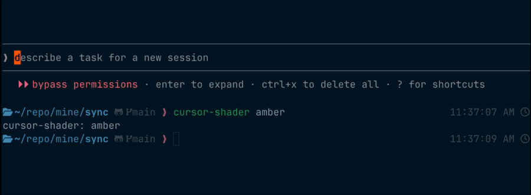

# ghostty-little-things

It's the little things that make a terminal nice.

Cursor shaders for [Ghostty](https://ghostty.org) on macOS. The shader draws the cursor, so the cursor can glide, glow, and blink like an old terminal.



## The cursors

All four use the same code. Only the constants at the top of each file are different.

| Profile | What it does |
|---|---|
| **amber** | Warm `#ffb000` block, soft glow, short glide. The cell it leaves fades out like old phosphor. My current one. |
| **vt220** | Green `#33ff66` block. No glide, it snaps. Short afterglow. The calmest one. |
| **cocoa** | Cursor in the text color. Quick glide, soft blink, no glow. Like the old Mac caret. |
| **glide** | White block that slides between cells. Soft blink. |

All of them:

- Stay solid while you type. The blink starts 0.6 s after the last move.
- Stop the blink after 5.5 s idle.
- Teleport on long jumps (TUI redraws), with no glide.
- Keep the letter under the block readable.

## Install

1. Copy the shaders:

   ```sh
   mkdir -p ~/.config/ghostty/shaders
   cp shaders/cursor-*.glsl ~/.config/ghostty/shaders/
   ```

2. Add these two lines to `~/.config/ghostty/config`. The shader draws the cursor, so Ghostty's own cursor must be hidden.

   ```
   cursor-opacity = 0
   custom-shader = "./shaders/cursor-amber.glsl"
   ```

3. Reload Ghostty with <kbd>⌘</kbd><kbd>⇧</kbd><kbd>,</kbd>.

To remove, delete the two lines.

## Switch cursors with one command

[`cursor-shader.zsh`](cursor-shader.zsh) switches the profile and reloads Ghostty.

1. Point a link at the profile you want:

   ```sh
   ln -sfn cursor-amber.glsl ~/.config/ghostty/shaders/cursor.glsl
   ```

2. In the Ghostty config, use the link: `custom-shader = "./shaders/cursor.glsl"`
3. Source `cursor-shader.zsh` in your `~/.zshrc`.

```sh
cursor-shader          # list profiles, * = active
cursor-shader vt220    # switch and reload
```

To make your own, copy a profile, change the constants, and name it `cursor-<name>.glsl`.

## Where the ideas came from

- **Glide:** thdxg's [`cursor_glide.glsl`](https://gist.github.com/thdxg/e43956748b9f685492011c2e8754080d), from [r/Ghostty](https://www.reddit.com/r/Ghostty/comments/1wg4p88/ghostty_smooth_cursor_animation_shader/)
- **Other cursor shaders:** [sahaj-b/ghostty-cursor-shaders](https://github.com/sahaj-b/ghostty-cursor-shaders), [cursor-smear](https://github.com/abdallahsoliman00/dotfiles/blob/main/ghostty/shaders/cursor-smear.glsl)
- **Amber and green phosphor:** [cool-retro-term](https://github.com/Swordfish90/cool-retro-term), [Monochrome monitor](https://en.wikipedia.org/wiki/Monochrome_monitor), [CRT phosphor research](https://ww.labguysworld.com/crt_phosphor_research.pdf)
- **VT220 block:** [VT220](https://en.wikipedia.org/wiki/VT220), [DECSCUSR](https://vt100.net/docs/vt510-rm/DECSCUSR), [Windows Terminal vs a real VT220](https://www.theregister.com/2020/09/23/windows_terminal_1_4/)
- **Blink timing:** [Raymond Chen](https://devblogs.microsoft.com/oldnewthing/20240916-00/?p=110272), [GetCaretBlinkTime](https://learn.microsoft.com/en-us/previous-versions/windows/desktop/dnacc/flashing-user-interface-and-the-getcaretblinktime-function), [Mozilla bug 1518196](https://bugzilla.mozilla.org/show_bug.cgi?id=1518196), [history of the blinking cursor](https://www.inverse.com/innovation/blinking-cursor-history)
